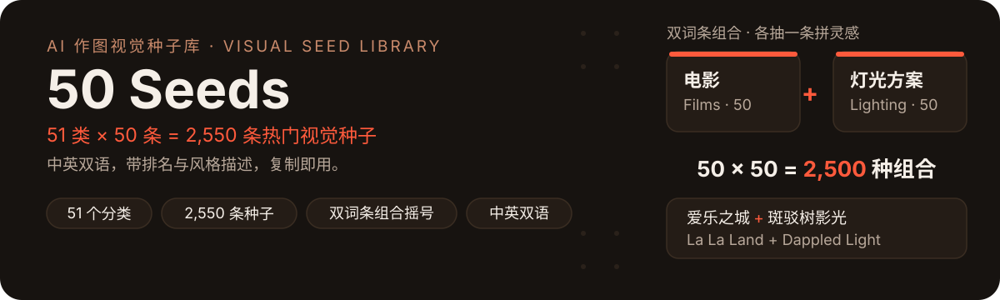

<p align="right"><a href="README.md">中文</a></p>

<p align="center">
  
</p>

<p align="center">
  <a href="https://xiaosang.cc/50-seeds/">▶ Play Online</a>
  ·
  <a href="https://holynova.github.io/50-seeds/">GitHub Pages Mirror</a>
  ·
  <a href="https://github.com/holynova/50-seeds">GitHub Repository</a>
</p>

50 Seeds is a library of popular visual seeds for AI image creation: 51 categories, 50 seeds each, 2,550 seeds in total, bilingual (Chinese/English) with popularity rankings and style notes — copy and paste straight into your prompt. The two-term combiner draws one seed from each of two categories to spark prompt ideas: two categories give 50 × 50 = 2,500 combinations.

## Screenshot

<p align="center">
  
</p>

## Features

- **Seed library**: 51 categories, 50 seeds each, in 5 groups (创作者 Creators 8, 视觉语言 Visual Language 10, 故事母题 Story Motifs 13, 空间物件 Spaces & Objects 11, 情绪自然 Mood & Nature 9). Every seed has a Chinese/English name, a style note, and an in-category rank (1–50, where 1 is the most popular overall).
- **Two-term combiner**: one or two categories, with an option to pin one side; each roll produces 5 fresh non-repeating pairs. Save favorites, copy combos, download JSON, or preview a Midjourney-style prompt. Shortcuts: `Space` re-roll, `1–5` copy one result, `A`/`B` switch channel, `/` focus search.
- **Favorites**: save seeds and combos locally and find them again anytime.
- **Bilingual**: the interface and prompts can switch between Chinese and English.
- **Light / dark themes**: high-contrast dual themes, responsive on mobile.

## Data Sources

Data snapshot dated 2026-07-31. Rankings blend current attention, major charts, long-term cultural impact, and prompt usefulness — not a live official metric. Reference sources:

| Source | Categories covered |
|---|---|
| IMDb Top 250 | Film |
| Steam Charts | Games |
| Best-selling manga (Wikipedia) | Japanese manga |
| Billboard Greatest Pop Stars | Singers |
| MoMA Art Terms | Art movements, media & photography |
| NASA Solar System Exploration | Celestial bodies |
| Wikimedia Pageviews | Cross-category public visibility |

## Run Locally

A pure static site with no build step — just open `index.html`, or serve it statically:

```bash
python3 -m http.server 8000
# Open http://localhost:8000
```

Data checks and tests (Node):

```bash
npm test   # data generation + combiner logic tests + data validation
```

## Tech

- Pure HTML + CSS + JS, zero build, zero runtime dependencies; responsive on mobile.
- Data: `data/seeds.json` (51 categories, 2,550 seeds); `src/catalog.mjs` and `src/catalog-extra.mjs` are the data sources, generated by `scripts/generate-data.mjs` and validated by `scripts/validate-data.mjs`; combiner logic lives in `src/combiner.mjs`.

```
index.html                  Entry (seed library / combiner two-view layout)
app.js                      UI logic: filtering, combining, favorites, copy, themes
styles.css                  Warm black background + madder-red accent, dual themes
data/seeds.json             51 categories × 50 seeds
src/catalog.mjs             Data source (part 1)
src/catalog-extra.mjs       Data source (part 2)
src/combiner.mjs            Combiner logic
scripts/                    Generation / validation / combiner tests
```
