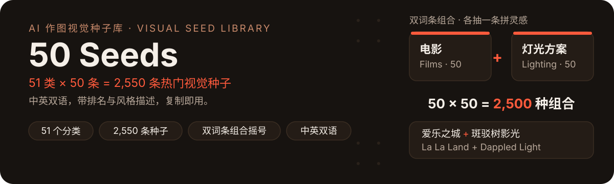

<p align="center">
  
</p>

<p align="center">
  <a href="https://xiaosang.cc/50-seeds/">▶ 在线体验 Play Online</a>
  ·
  <a href="https://holynova.github.io/50-seeds/">GitHub Pages 备选镜像</a>
  ·
  <a href="https://github.com/holynova/50-seeds">GitHub 仓库</a>
</p>

50 Seeds 是给 AI 作图准备的热门视觉种子库：51 个类别、每类 50 条、共 2,550 条种子，中英双语，带热度排名与风格描述，复制即用。还有双词条组合摇号：从两个分类各抽一条种子，拼成提示词灵感，两个分类就是 50 × 50 = 2,500 种组合。

50 Seeds is a library of popular visual seeds for AI image creation: 51 categories, 50 seeds each, 2,550 seeds in total, bilingual (Chinese/English) with popularity rankings and style notes — copy and paste straight into your prompt. The two-term combiner draws one seed from each of two categories to spark prompt ideas: two categories give 50 × 50 = 2,500 combinations.

## 截图 / Screenshots

<p align="center">
  
</p>

## 功能 / Features

- **种子库**：51 个类别、每类 50 条，分属 5 大分组（创作者 8 类、视觉语言 10 类、故事母题 13 类、空间物件 11 类、情绪自然 9 类）。每条种子有中英名称、风格描述与类内排名（1–50，1 为综合热度最高）。
- **双词条组合摇号**：单分类或双分类，支持固定一侧种子；每次生成 5 组不重复结果，可收藏、复制组合、下载 JSON、看 MJ 预览。键盘快捷键：`Space` 重新摇号、`1–5` 复制单条、`A`/`B` 切换通道、`/` 聚焦检索。
- **收藏**：喜欢的种子与组合本地收藏，随时找回。
- **中英双语**：界面与提示词均可切换中英文对照。
- **日间 / 夜间主题**：高对比双主题，移动端响应式。

## 数据来源 / Data Sources

数据快照日期 2026-07-31。排名综合当前关注度、主流榜单、长期文化影响力与 AI 作图适用性，并非实时官方统计。参考来源：

| 来源 | 覆盖类别 |
|---|---|
| IMDb Top 250 | 电影 |
| Steam Charts | 游戏 |
| Best-selling manga（维基百科） | 日本漫画 |
| Billboard Greatest Pop Stars | 歌手 |
| MoMA Art Terms | 艺术流派、媒介与摄影 |
| NASA Solar System Exploration | 宇宙天体 |
| Wikimedia Pageviews | 跨类别公众可见度 |

## 本地运行 / Run Locally

纯静态站，零构建，直接打开 `index.html` 即可；或起一个静态服务器：

```bash
python3 -m http.server 8000
# 打开 http://localhost:8000
```

数据校验与测试（Node）：

```bash
npm test   # 生成数据 + 组合逻辑测试 + 数据校验
```

## 技术 / Tech

- 纯 HTML + CSS + JS，零构建、零运行时依赖；移动端响应式。
- 数据：`data/seeds.json`（51 类、2,550 条）；`src/catalog.mjs` 与 `src/catalog-extra.mjs` 是数据源，`scripts/generate-data.mjs` 生成、`scripts/validate-data.mjs` 校验；组合逻辑在 `src/combiner.mjs`。

```
index.html                  入口（种子库 / 组合摇号双视图）
app.js                      界面逻辑：筛选、组合、收藏、复制、主题
styles.css                  暖黑底 + 茜红强调，双主题
data/seeds.json             51 类 × 50 条种子数据
src/catalog.mjs             数据源（上）
src/catalog-extra.mjs       数据源（下）
src/combiner.mjs            组合摇号逻辑
scripts/                    生成 / 校验 / 组合测试
```

## English

**50 Seeds** is a library of popular visual seeds for AI image creation: 51 categories × 50 seeds = 2,550 seeds, each with a Chinese/English name, a style note, and an in-category popularity rank (1–50).

- **Library**: browse 51 categories in 5 groups (Creators 8, Visual Language 10, Story Motifs 13, Spaces & Objects 11, Mood & Nature 9). Every seed is bilingual and copy-ready.
- **Two-term combiner**: pick one or two categories, pin one side if you like, and roll 5 fresh non-repeating pairs. Save favorites, copy combos, download JSON, or preview a Midjourney-style prompt. Shortcuts: `Space` re-roll, `1–5` copy one result, `A`/`B` switch channel, `/` focus search.
- **Data**: snapshot dated 2026-07-31. Rankings blend current attention, major charts, long-term cultural impact, and prompt usefulness — not a live official metric. Sources include IMDb Top 250, Steam Charts, best-selling manga, Billboard, MoMA Art Terms, NASA, and Wikimedia Pageviews.
- **Run it**: static site, no build step — open `index.html`. Data checks: `npm test`.
- **Tech**: vanilla HTML + CSS + JS, zero runtime dependencies. Data lives in `data/seeds.json`; generation and validation scripts are under `scripts/`.
