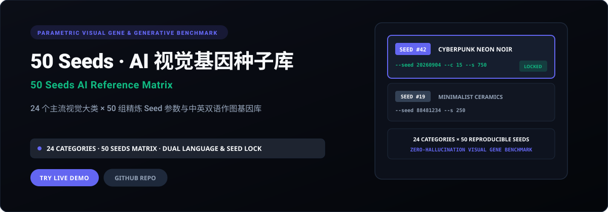

<p align="right">
  <strong>简体中文</strong> · <a href="./README.en.md">English</a>
</p>

<p align="center">
  
</p>

<p align="center">
  <a href="https://50-seeds.xiaosang.cc/"><strong>🌐 在线体验 (Live Demo)</strong></a> · 
  <a href="https://holynova.github.io/50-seeds/"><strong>🚀 备选镜像 (GitHub Pages)</strong></a> · 
  <a href="https://github.com/holynova/50-seeds"><strong>📦 GitHub 源码</strong></a> · 
  <a href="https://xiaosang.cc/"><strong>✨ 更多作品集</strong></a>
</p>

---

## 真实预览 (Proof of Work)

<p align="center">
  
</p>

---

## 项目简介 (What It Is)

面向 AI 作图的视觉关键词库：51 个类别，每类 50 条，共 2,550 条中英对照条目。这里的“种子”指人物、风格、场景等创作参考词，不是图像生成器的数值随机种子，也不保证跨模型复现相同画面。

## 可以怎样使用

- 搜索或按类别浏览，复制中英文关键词。
- 在组合器中选择两类条目，固定想保留的参考词，再生成组合。
- 收藏候选词，批量复制结果，或下载 JSON 继续整理。
- 切换语言和明暗主题，按自己的阅读习惯浏览。

数据来源文件为 [data/seeds.json](data/seeds.json)，组合器逻辑位于 [src/](src/)。

## 快速开始 (Quick Start)

### 1. 在线体验
无需安装任何环境，直接在浏览器中打开：
- 🌐 **主站演示 (Primary)**：[https://50-seeds.xiaosang.cc/](https://50-seeds.xiaosang.cc/)
- 🚀 **备选镜像 (GitHub Pages)**：[https://holynova.github.io/50-seeds/](https://holynova.github.io/50-seeds/)

### 2. 本地运行与调试
克隆仓库后执行以下命令：

```bash
git clone https://github.com/holynova/50-seeds.git
cd 50-seeds
python3 -m http.server 4173
```

---

打开 [localhost:4173](http://localhost:4173)。页面通过 `fetch` 加载 JSON，请通过 HTTP 服务访问。维护数据后可运行 `npm test`，生成并验证词库及组合器。

## 开源协议与作者 (License & Author)

- **作者**：[holynova (小桑)](https://xiaosang.cc/)
- **授权说明**：仓库当前未附独立 LICENSE 文件；复用代码或素材前请确认相应授权。
- **合辑收录**：本仓库作为精选项目收录于 [Where Craft Lives (xiaosang.cc)](https://xiaosang.cc/)。
